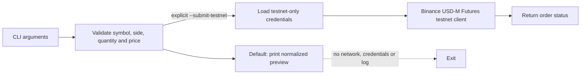

# FutureForge architecture

## Boundaries

- `src/market_orders.py` and `src/limit_order.py` are the two supported entry points.
- Preview mode is the default and is designed not to load keys or contact Binance.
- Submission requires the explicit `--submit-testnet` flag; endpoint configuration is hard-wired to testnet.
- Credentials are local `.env` values and must not be placed in public CI, web frontends, or committed files. Disable withdrawals and never reuse mainnet credentials.
- Tests use isolated processes with secrets removed; no real exchange order is sent by CI.

## ADR-001: keep the tool local and testnet-only

**Decision:** Keep FutureForge as a small local CLI and preserve the testnet-only endpoint. Preview remains the default.

**Reason:** The product is useful as an API learning example; it has no validated buyer, durable hosted service, or proven trading strategy. Mainnet support would add material financial and key-handling risk without serving the current learning use case.

**Trade-offs:** No web dashboard, user account, hosted credentials, or cloud order history. Learners need their own demo account to submit orders.

**Rejected:** Mainnet trading, copy-trading, signal generation, and unattended strategies. Those would change the product and safety profile substantially.
